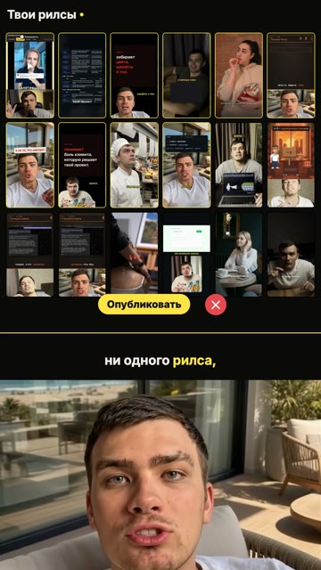
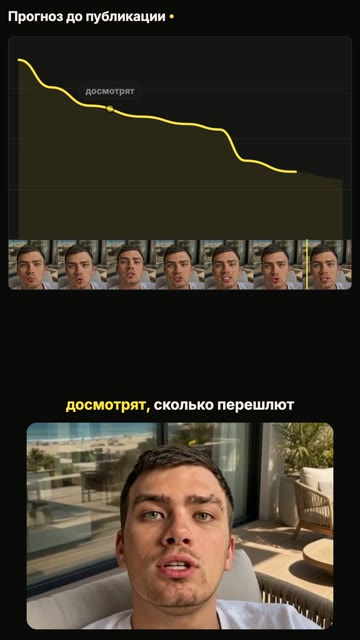
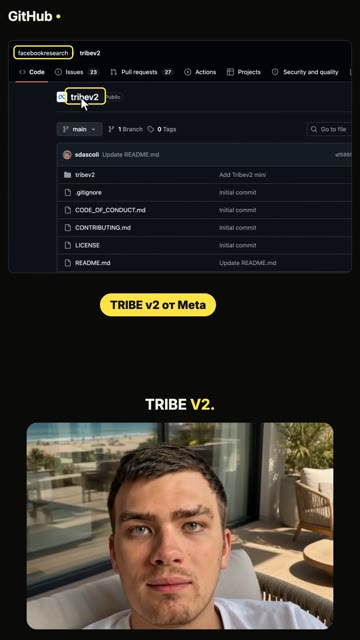
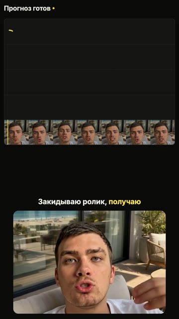

# Урок. Монтаж видео

Ты кидаешь Claude сырое видео, а через 10–20 минут получаешь готовый вертикальный ролик. В нём вырезаны все дубли, запинки, вдохи и паузы, сверху живые экраны того, о чём ты говоришь, посередине субтитры по словам, внизу твоё лицо крупной карточкой. Стиль `ui` уже настроен. Любой другой стиль Claude скопирует с чужого ролика по ссылке.

Делай шаги строго по порядку. Текст в серых блоках копируй целиком: наведи мышку на блок, справа появится кнопка копирования.

Пример готового ролика в стиле ui: [docs/ui-demo.mp4](docs/ui-demo.mp4).

<p>
   
</p>

---

## Что нужно заранее

- Установленная система сценариев из урока 1: папка `scenarios` в домашней папке. Ключи оттуда монтаж возьмёт сам.
- Google Chrome.
- Подписка Claude Pro или Max.
- 3 ГБ свободного места: если ключа расшифровки нет, на компьютер скачается модель whisper (~1,6 ГБ).
- Сырое видео: вертикальное, снятое на телефон, или видео с аватаром HeyGen из урока про аватар.

---

## Шаг 1. Установить монтаж · 10 минут

Открой систему как обычно:

1. Терминал (Mac) или PowerShell (Windows).
2. Команды по очереди, после каждой Enter:
   ```
   cd ~/scenarios
   ```
   ```
   claude --dangerously-skip-permissions
   ```

Вставь в Claude текст целиком и нажми Enter:

```
Установи мне модуль монтажа. Делай сам, команды запускай сам, у меня спрашивай только ключи.

1. Определи систему: macOS или Windows. Проверь, что есть ffmpeg и Python 3.10 или новее. Нет ffmpeg – Mac: brew install ffmpeg, Windows: winget install Gyan.FFmpeg.
2. Скачай https://github.com/artemregi/montage/archive/refs/heads/main.zip и распакуй в мою домашнюю папку так, чтобы получилась папка montage, а внутри сразу файлы install.py, doctor.py, CLAUDE.md и папки tools, styles, docs. Если папка montage уже есть – не трогай в ней .env, projects, refs, готовые и раздел «Правила автора» в CLAUDE.md, остальные файлы замени. Архив и временную папку удали.
3. В папке montage запусти install.py (Mac – python3 install.py, Windows – python install.py). Если на Windows python не находится или открывает Microsoft Store – используй py -3.12.
4. Запусти doctor.py и покажи таблицу целиком. Ключи Groq и ElevenLabs берутся из ~/scenarios/.env. Если ключ Groq ❌ – попроси у меня новый (console.groq.com → API Keys) и впиши в ~/montage/.env строкой GROQ_API_KEY=. Значения ключей никогда не выводи на экран. Строка «Есть чем расшифровывать» должна быть ✅. Остальные ❌ почини и проверь ещё раз.
5. В конце напиши мне: «Закрой это окно. Монтаж открывай так: cd ~/montage, потом claude --dangerously-skip-permissions».
```

**Готово, когда** doctor.py пишет «Всё готово к монтажу».

Закрой окно, как скажет Claude.

---

## Как открывать монтаж (каждый раз)

1. Терминал (Mac) или PowerShell (Windows).
2. Команды по очереди:
   ```
   cd ~/montage
   ```
   ```
   claude --dangerously-skip-permissions
   ```
3. В первый раз в этой папке появится «Accessing workspace»: **стрелка вниз ↓**, потом **Enter**.

В этой папке лежит файл `CLAUDE.md` с правилами монтажа. Claude читает его сам при каждом запуске, повторять ему правила не нужно.

---

## Шаг 2. Как снимать, чтобы монтаж был чистым · прочитать 2 минуты

Claude вырежет любые дубли, но чем понятнее дубль, тем точнее результат.

- **Ошиблась – помолчи секунду и скажи фразу заново с начала.** Не с середины слова, а с начала предложения. Тогда видно, где старая попытка и где новая.
- **Удачная попытка – последняя.** Claude всегда оставляет последнюю целую версию фразы. Записала хорошо, а потом решила «ещё раз» и сказала хуже – скажи фразу третий раз.
- Можно вслух: «ещё раз», «заново», «стоп». Claude вырежет и это слово, и всё до него.
- Первое слово хука говори сразу, без «так», «ну что» и вдоха в камеру. Вдох Claude всё равно вырежет, но хук звучит живее.
- Тихая комната. Телефон на штативе на уровне глаз, лицо в верхней половине кадра. Не уходи из кадра и не наклоняйся сильно: лицо идёт в карточку, и если голова выйдет за край, её обрежет.
- Снимай вертикально, 1080p или 4K, 30 кадров. HDR с iPhone можно не выключать: Claude переведёт цвет сам.
- Сценарий из Telegram держи перед глазами: по нему Claude проверяет, что каждая фраза есть в ролике ровно один раз.

---

## Шаг 3. Первый монтаж · 20 минут

1. Открой монтаж (раздел выше).
2. Перетащи видео с компьютера мышкой прямо в окно терминала: вставится путь к файлу. Вырежи его (Cmd+X или Ctrl+X): он понадобится в промпте ниже.
3. Вставь в Claude текст, заменив то, что в угловых скобках:

```
Смонтируй ролик <путь к видео> в стиле ui. Делай сам по CLAUDE.md, ничего не пропускай: подготовка, расшифровка по кускам, решение по каждому куску, вырезка, проверка verify.py, план, кроп лица по сетке, контрольные кадры, рендер, проверка готового ролика.
Сценарий ролика: <вставь текст сценария из Telegram или напиши «без сценария»>.
Кодовое слово в призыве: <слово>. Мой ник в Instagram: <ник>.
Для наглядности есть мои скриншоты: <пути к файлам или «нет»>.
В конце пришли путь к готовому файлу, сколько и чего вырезано и что под вопросом.
```

Если видео из нескольких файлов (хук, начинка, призыв) – перетащи все по порядку через пробел.

Claude будет присылать короткий статус по шагам. Расшифровка на компьютере без ключа идёт 2–5 минут, рендер 2–6 минут.

**Готово, когда** Claude прислал путь к файлу в папке `готовые`. Открой его и посмотри целиком.

---

## Шаг 4. Как проверить результат · 5 минут

Смотри ролик со звуком от начала до конца и проверь:

- [ ] Ни одна фраза не звучит дважды, нет оборванных начал фраз.
- [ ] Не пропало нужное: все мысли из сценария на месте.
- [ ] Нет пауз, вдохов, «э-э».
- [ ] Лицо крупно в каждом кадре, голова не обрезана.
- [ ] Субтитры без ошибок, названия написаны правильно.
- [ ] Цвета как на телефоне в галерее, не блёклые.
- [ ] Ролик короче минуты.

Что вырезано и почему – в файле `projects/<имя>/cuts.md`, отчёт проверки – в `projects/<имя>/verify.md`.

---

## Шаг 5. Правки · сколько нужно

Пиши Claude словами, с таймкодом из готового ролика:

```
На 0:12 остался дубль «готовит музыку». Проверь этот кусок и соседние, найди все такие же места по всему ролику и пересобери.
```

```
Вырезал нужное: на 0:21 пропала фраза «понимает боль клиента». Верни и проверь, не вырезано ли ещё что-то так же.
```

```
Лицо в карточке мелкое и голова обрезана сверху на 0:30. Подбери кроп заново по сетке и проверь на начале, середине и конце.
```

```
Субтитры: «клод» → Claude, «хейген» → HeyGen. Пересобери.
```

Хочешь, чтобы правка действовала во всех следующих роликах, – начни с «Запомни:». Claude допишет её в `CLAUDE.md`, раздел «Правила автора».

---

## Шаг 6. Скопировать чужой стиль · 30–60 минут

Нашла ролик, монтаж которого хочешь так же. Открой монтаж и вставь:

```
Скопируй стиль монтажа этого ролика 1 в 1: <ссылка на ролик или путь к файлу>. Имя стиля: <короткое имя латиницей, например jack>.
Делай по docs/copy-style.md: разбери ролик tools/ref.py, посмотри все листы кадров и переходы покадрово, заполни STYLE.md цифрами по шаблону, сделай движок styles/<имя>/reel.py на основе ui, смонтируй пробу на моём видео <путь к видео> и сравни кадры с референсом рядом, пока не совпадёт.
Правила вырезки дублей и лица из CLAUDE.md действуют и в этом стиле.
В конце покажи 4 пары кадров «референс – наш» и пришли путь к пробному ролику.
```

Дальше этим стилем монтируй так же, как в шаге 3, только «в стиле <имя>».

Если Instagram не отдаёт ролик – сохрани его на телефон (или запиши экран), перекинь на компьютер и дай путь к файлу.

---

## Каждый день

1. Записала ролик по сценарию.
2. Открыла монтаж, перетащила видео, вставила промпт из шага 3.
3. Посмотрела, поправила словами, выложила.

Видео с аватаром HeyGen лежат в `~/scenarios/video`: их монтируй тем же промптом, дубли там тоже бывают, если в голосовом были повторы.

---

## Если что-то не работает

Открой монтаж и вставь:

```
Запусти doctor.py, покажи таблицу и почини всё, что ❌. Потом проверь последний проект в projects: какие файлы есть, на каком шаге остановилось, и доведи до готового ролика по CLAUDE.md.
```

Частые причины:
- **«Ключ Groq недействителен»** – ключ истёк. console.groq.com → API Keys → новый ключ, Claude впишет его в `.env`.
- **«Не расшифровались куски»** – лимит или сеть. Запустить ещё раз: готовые куски берутся из кэша.
- **Блёклые цвета** – пришли Claude скриншот того же кадра из галереи телефона.
- **Рендер падает на Chrome** – обнови Google Chrome и запусти doctor.py.
- **Долгая расшифровка** – без ключа whisper работает на компьютере. С ключом Groq быстрее и бесплатно.

---

## Как это устроено

| Шаг | Что делает | Файл |
|---|---|---|
| Подготовка | 30 кадров/с, HDR → обычный цвет | `tools/prep.py` |
| Расшифровка по кускам | режет по паузам, каждый кусок отдельно – дубль не «склеивается» | `tools/transcribe.py` |
| Подсказки по дублям | ДУБЛЬ, ФАЛЬСТАРТ, КОНЕЦ ПОВТОРЯЕТСЯ, ПОХОЖЕ ПО СМЫСЛУ, МЕЖДУ ДУБЛЕМ… | `tools/takes.py` |
| Вырезка | по решению на каждый кусок, границы по громкости, паузы ~0,16 с | `tools/cut.py` |
| Проверка | готовый звук режется ещё мельче и расшифровывается заново | `tools/verify.py` |
| План | слова ролика со временем, заготовка сцен | `tools/plan.py` |
| Кадры | сетка для кропа лица, проверка кропа, листы кадров | `tools/frames.py` |
| Скриншоты | настоящие страницы без cookie-окон | `tools/shot.py` |
| Стиль ui | движок и правила | `styles/ui/` |
| Чужой стиль | разбор референса на кадры и цифры | `tools/ref.py`, `docs/copy-style.md` |

Правила для Claude – [CLAUDE.md](CLAUDE.md). Ошибки, от которых они защищают, – [docs/mistakes.md](docs/mistakes.md).
